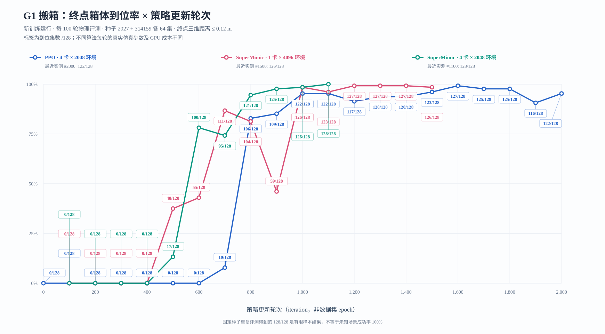
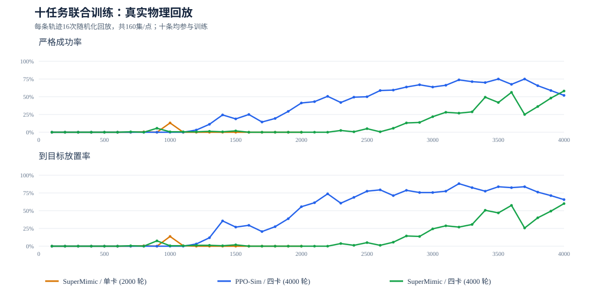

# 🤖 G1 Carry & Place：SuperMimic vs PPO

本仓库主要想看看 Supermimic 能不能做到：

**一条 10 秒的抱箱示范，能不能教会 G1 走过去、双手抱起、搬到另一边放稳？**

仅在仿真环境 mjlab + MuJoCo Warp 中实现，挑的是 SUGAR CarryBox 的轨迹自己加上箱子并修正。评测时先看箱子最终是否到目标附近的主指标，再分别看取搬放过程与持续双手抓握的过程指标。对比方法：
-  **PPO-Sim**: 真实物理采样 + PPO
-  **SuperMimic**: 世界模型 + 可微分想象更新

| 训练轨迹 | SuperMimic  （间歇持物） | SuperMimic （严格成功） | PPO  （严格成功） |
|:---:|:---:|:---:|:---:|
|  |  |  |  |

## ✨ 30 秒看结论：单卡、四卡 SuperMimic 与 PPO

| 方案 | GPU | 并行仿真数 | 训练时间 | 真实交互总量 | 训练峰值显存 | 主指标 终点箱体到位 | 过程指标 间歇持物 | 过程指标 连续双手 |
|:---:|---|---|---:|---:|---|:---:|:---:|:---:|
| **SuperMimic**   1300 epoch 🤗 [ckpt](https://huggingface.co/BlossomsGarden/G1-Carry-Place-Supermimic-vs-PPO/blob/main/checkpoints/supermimic_continued/model_1300.pt) | 单卡 4090 | 1x4096 | 5.04 h | 1,357.4 万 | 11.9 GB |  128/128 = 100.0% | 102/128 = 79.7% | 0/128 = 0.0% |
| **PPO-Sim**   4000 epoch 🤗 [ckpt](https://huggingface.co/BlossomsGarden/G1-Carry-Place-Supermimic-vs-PPO/blob/main/checkpoints/ppo/model_3999.pt) | 4卡 4090 | 4x2048 | 2.58 h | 7.864 亿 | 6.2 GB | 127/128 = 99.2% | 127/128 = 99.2% | 53/128 = 41.4% |
| **SuperMimic**   1500 epoch 🤗 [ckpt](https://huggingface.co/BlossomsGarden/G1-Carry-Place-Supermimic-vs-PPO/blob/main/checkpoints/supermimic_4gpu/model_1500.pt) | 4卡 4090 | 4x2048 | 2.49 h | 3,098.2 万 | 6.5GB | 128/128 = 100.0% | 127/128 = 99.2% | 7/128 = 5.5% |

训练成本比较：四卡 SuperMimic 达到这次样本到位率用了 **3,098.2 万次真实交互、11.10 GPU·h**；PPO 全程用了 **7.864 亿次真实交互、10.30 GPU·h**。前者仿真交互约少 **25.4 倍**，训练卡时却略多；且连续双手成功率 **7/128 vs 53/128**。

[逐阶段核查](docs/RESULTS.md#ppo-的逐检查点终点学习曲线)：PPO 第 2,000 轮已到位 **127/128**，举升和空中搬运也各 **127/128**；但举升附近双手都碰到箱子的只有 **1/128**，间歇持物也仅 **1/128**。到第 2,500 轮到位仍为 127/128，间歇持物已提高到 **124/128**。

主指标只判位置：每条物理回放的最后一帧，箱中心与目标中心的三维距离 ≤ 0.12 m 则记 1，否则记 0。间歇持物的依据是：箱子确实离地搬运至少 0.5 米、到目标处放下并稳定；举升前后的一小段时间里，左右手各自至少碰到过箱子；在离地搬运区间，至少一只手碰箱的帧数占比达到 20%。因此两手可以交替接触，中途也允许暂时都不接触。这是比“全程连续双手抱箱”宽松得多的成功定义。

## 🧪 四个 SuperMimic 配方：单卡 4,096 环境

相同训练种子 0、相同一条 500 帧示范、相同 1,000 轮上限；**先用种子 0 的 16 条开发集选择检查点**，再用种子 2027 / 314159 / 161803 各 64 条评测。H 是**每个想象起点向未来展开的步数**，朝向 std 是箱体**朝向奖励尺度**（rad），不是仿真环境数或动作噪声。

| H / 朝向 std | GPU | 训练时长 | 峰值显存 | 主指标 终点箱体到位 | 过程指标 间歇持物 | 过程指标 连续双手 |
|---|---:|---:|---:|:---:|:---:|:---:|
| 32 / 0.4 | 单卡4090 | 1000 epoch 3.83 h | 11,754 MiB | 178/192 = 92.7% | 153/192 = 79.7% | 0/192 |
| 16 / 0.4 | 单卡4090 | 800 epoch 1.91 h |  10,904 MiB | 175/192 = 91.1% | 102/192 = 53.1% | 0/192 |
| **32 / 1.2** | **单卡4090** | **1,000 epoch 3.75 h** |  **11,754 MiB** | **188/192 = 97.9%** | **168/192 = 87.5%** | 0/192 |
| 16 / 1.2 | 单卡4090 | 800 epoch 1.94 h |  10,904 MiB | 131/192 = 68.2% | 93/192 = 48.4% | 0/192 |

消融取舍：H16 快约 1.6×，但“更新更快”不必然等于“最终抱箱更稳”。H32/1.2 可以在一张 4090 上约 3.75 小时训出明显可见的取搬放，但持续双手握持仍是**0/192**（PartyMimic 团队在另一套 LAFAN 动作跟踪消融中，测得缩短到 H=16 比 H=32 的基线差，并认为短时域更依赖 critic 的终端价值）。而消融 std 主要是想检验：给朝向偏差较大的策略更明显的奖励信号，能否帮助它逐渐学会把箱子转正。代价是接近目标时，较大的 std 对小角度误差区分得更弱；所以它并非必然更好。[更细的时序与失败原因 →](docs/RESULTS.md)

$$
r_{\text{box-ori}}
= 0.5\exp\left(-\frac{\Delta\theta^2}{\sigma_{\text{box-ori}}^2}\right)
$$

其中，$\Delta\theta$ 是箱体实际朝向与参考朝向之间的旋转角误差（弧度）；不过目前确实证明有影响，但是没有进一步详细测试。

## 🧠 方法：同任务，梯度路径不同

~~~mermaid
flowchart LR
    D["SUGAR data_098 1 条 × 500 帧"] --> R["G1 + 箱体参考 足底/手箱几何修正"]
    R --> E["mjlab + MuJoCo 真实接触、同观测与域随机化"]
    E --> P["PPO-Sim 物理 rollout + 优势估计"]
    E --> M["SuperMimic 真实 replay → 世界模型"]
    M --> I["4,096 个想象起点 H16 / H32 可微展开"]
    P --> V["统一物理复评 终点三维到位 + 两项过程指标"]
    I --> V
~~~

- **PPO-Sim** 从仿真批量采集实际交互，经 PPO 优势估计/更新策略；训练步速高，消耗更多**真实仿真**转换。这里的 `--learner ppo` 不是仓库别处的 AMP-PPO Lift 实验。
- **SuperMimic** 从真实仿真数据拟合状态转移模型，在模型里用 4,096 个起点做短时域想象，将跟踪奖励梯度穿过世界模型更新策略；模型误差、接触非光滑和箱体终点姿态都可能影响操作。`16×256` 是同一次 4,096 起点更新的**显存分块**，不是四个 epoch，也不是多开 4,096 个真实仿真环境。
- **观察与局限**：世界模型接收机器人+箱体的状态与随机化信息（含 84 维物理状态），本实验没有摄像头闭环、力觉或真机验证；仿真中特权状态可得不代表真机可直接部署。[模型输入与实现](src/mjlab_g1/rl/supermimic/features.py) · [策略更新](src/mjlab_g1/rl/supermimic/algorithm.py)。

## 📦 Dataset 与任务

- **只训练一条参考**：SUGAR CarryBox `data_098`，10 秒、50 Hz、500 帧；同时含 G1 29 关节、身体轨迹、箱体 6D 位姿/速度和接触标签。源 processed 数据虽有 100 条、49,043 帧（87 条可转换），当前策略**只读一条修正后的 v2**。原轨迹→接触 v1→足底+手箱 v2 的文件和 [SHA/字段说明](dataset/README.md) 随仓库提供。
- **物理任务**：29 DoF G1，0.5 kg 箱体（约 0.400×0.546×0.536 m），从地面取、至少离地搬运 0.5 m、到目标区域松手并站稳；控制 50 Hz。示范的箱体位姿是追踪目标，**不是强制绑定到机器人手上**。[任务定义](src/mjlab_g1/tasks/smtrack/env_cfgs.py) · [真实物理评分](src/mjlab_g1/tasks/smtrack/carryplace_eval.py)。
- **为何修正参考**：原始转换的持物时手箱穿透 p95 达 9.51 cm，接近阶段仅 23.0% 的帧有脚部接地；v2 几何审计分别改善为 0.21 cm 和 98.7%。几何修正并不保证动力学可实现。[数据审计](dataset/README.md)。

## 🛠️ 环境与复现入口

实测：**Ubuntu 20.04.1 LTS · RTX 4090 · 驱动 550.144.03 · Python 3.10.13（wan） · PyTorch 2.6.0+cu124 · mjlab 1.4.0 · MuJoCo 3.10.0 · mujoco-warp 3.8.0.3 · warp-lang 1.14.0**。GPU 驱动安装于**宿主机**，仅有 conda 环境不足以运行 CUDA 仿真；源码直跑与新建环境的 Python 版本边界见 [ENVIRONMENT.md](docs/ENVIRONMENT.md)。本仓库不使用上游 `uv.lock` 的更新版 torch 解析结果覆盖 2.6.0。

~~~bash
# 仓库根目录，已进入具备上述依赖的 Linux conda 环境
python scripts/verify_report.py
python scripts/rescore_terminal_placement.py  # 重新评分旧物理回放，不需要 GPU
hf download BlossomsGarden/G1-Carry-Place-Supermimic-vs-PPO --include 'checkpoints/*/model_*.pt' --local-dir .  # 首次克隆后下载四份归档权重
export PYTHONPATH=src MUJOCO_GL=disable
python -m unittest discover -s tests -p 'test_carryplace_eval.py' -v
bash scripts/eval_checkpoints.sh supermimic 0 2027 64  # 另跑新的 64 集物理评测
# 同 learner、同种子使用固定输出名；比较下一权重前请先另存（见 REPRODUCE.md）
bash scripts/eval_checkpoints.sh supermimic 0 2027 64 checkpoints/supermimic_4gpu/model_1500.pt
bash scripts/eval_checkpoints.sh ppo 0 2027 64

# 历史 PPO 配方：4 卡 × 2,048 环境 = 全局 8,192
CARRY_MASTER_PORT=29571 CARRY_SAVE_INTERVAL=100 bash scripts/run_carry_experiment.sh \
  ppo 0,1,4,5 8192 4000 cp_ppo_v2_s0_4g

# 最佳 SuperMimic 配方：cuda:6 单卡、4,096 环境，H32 / std1.2
CARRY_SAVE_INTERVAL=100 bash scripts/run_carry_experiment.sh \
  supermimic 6 4096 1000 sm4096_h32_ori12_s0 \
  --imag-microbatches 16 --lr-cosine-iters 250000 --imagination-horizon 32 --box-ori-std 1.2
~~~

四份 [checkpoint](checkpoints/README.md) 托管在 [Hugging Face 模型仓库](https://huggingface.co/BlossomsGarden/G1-Carry-Place-Supermimic-vs-PPO)，GitHub 保留各自的原始 `params/agent.json`；评测脚本默认选择原始权重，第 5 个参数可选择续训或四卡权重。两条从头训练各耗时数小时；重训、64 集随机化物理评测与完整命令见 [REPRODUCE.md](docs/REPRODUCE.md)。`scripts/verify_report.py` 和 `scripts/rescore_terminal_placement.py` 只处理归档数据，不伪装成新的训练或 GPU 实验。

## 🔎 碎碎念

1. **视觉与判据分层**：最佳配方箱子终点到位 97.9%、间歇持物完整流程 87.5%，同时不间断双手仍 0%；[一个“看似成功”的严格失败片段](assets/demo_sm_contact_failure.gif)与[接触时序](assets/sm2000_seed314159_episode47_contact_timeline.png)可以直观解释差异。
2. **物理状态反证评分器**：箱中心 0.924 m 时仍标“触地”不可能；网格最大顶点半径 0.29545 m。只过滤中心高度 >0.33 m 的假触地后重评，保留低位拖行和真正失败；几何变更时阈值必须重推。[修正、回归与回放证据](docs/RESULTS.md)。
3. **下一项真正值得做的实验**：给双手相对箱体的接触/滑动设置独立指标和训练约束，再用**多个训练种子**、相同 GPU·h/仿真步预算、统一严格物理判据复评；箱重 3 kg、不同箱型与真实传感器闭环尚未在本仓库证明。

代码来源与资产许可边界见 [THIRD_PARTY.md](THIRD_PARTY.md)。这是**单任务工程复现**，没有声称实现 SUGAR 论文原 tracker、复现未开源视频作者的私有代码或验证 SuperMimic 论文的 1000× 数字。

| 算法 | 训练 GPU | 同时环境数 | 训练轮数 | 训练耗时 | 仿真交互数 | 训练显存峰值（MiB） | 最终严格成功 | 评测中最佳严格成功（轮） | 搬运 | 放置 |
|---|---|---:|---:|---:|---:|---|---:|---:|---:|---:|
| SuperMimic / 单卡 | cuda:0 | 4,096 | 2,000 | 7.61 h | 20,742,144 | 0: 11,947 | 0.0% | 13.1%（1,000） | 0.0% | 0.0% |
| PPO-Sim / 四卡 | cuda:4,5,6,7 | 8,192 | 4,000 | 2.65 h | 786,432,000 | 4: 6,233；5: 4,894；6: 4,894；7: 4,894 | 51.9% | 75.0%（3,500） | 95.6% | 65.6% |
| SuperMimic / 四卡 | cuda:4,5,6,7 | 8,192 | 4,000 | 6.07 h | 82,444,288 | 4: 7,737；5: 6,610；6: 6,610；7: 6,610 | 58.1% | 58.1%（4,000） | 63.7% | 60.0% |
