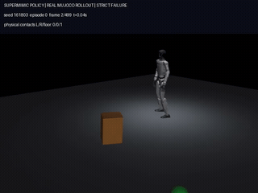
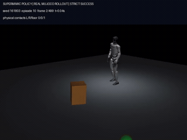

# 🤖 G1 Carry & Place：SuperMimic vs PPO

本仓库主要探究一个问题：

**一条 10 秒的抱箱示范，能否教会 G1 走过去、双手抱起、搬到另一处并放稳？**

仅在仿真环境 **mjlab + MuJoCo Warp** 中实现，使用 SUGAR CarryBox 的轨迹，评测时先看箱子最终是否到目标附近，再分别看取搬放过程与持续双手抓握。对比方法：
-  **PPO-Sim**: 真实物理采样 + PPO
-  **SuperMimic**: 世界模型 + 可微分想象更新

| 训练轨迹 | SuperMimic  （间歇持物） | SuperMimic （严格成功） | PPO  （严格成功） |
|:---:|:---:|:---:|:---:|
|  |  |  |  |

## ✨ 30 秒看结论：单卡、四卡 SuperMimic 与 PPO

| 方案 | GPU | 并行仿真数 | 训练至权重 / 完整训练 | 真实交互总量 | 稳态真实环境步/秒 | 训练峰值显存 | **主指标：终点箱体到位** | 过程：间歇持物 | 过程：连续双手 |
|:---:|---|---|---:|---:|---:|---|---:|---:|---:|
| **SuperMimic 单卡续训 H32 / std 1.2，第 1,300 轮（复测通过）** 🤗 [ckpt](https://huggingface.co/BlossomsGarden/G1-Carry-Place-Supermimic-vs-PPO/blob/main/checkpoints/supermimic_continued/model_1300.pt) | 单卡 4090 | 1x4096 | **5.04 h / ≤5.19 h** | 1,357.4 万 | 685 | 6：11,934 MiB | **128/128 = 100.0%**（同卡复测 128/128 = 100.0%） | 102/128 = 79.7% | 0/128 = 0.0% |
| **PPO-Sim：第 3,999 轮** 🤗 [ckpt](https://huggingface.co/BlossomsGarden/G1-Carry-Place-Supermimic-vs-PPO/blob/main/checkpoints/ppo/model_3999.pt) | 4卡 4090 | 4x2048 | **2.58 h / 2.58 h** | 7.864 亿 | 86,216 | 6,288 / 4,922 / 4,922 / 4,922 MiB | **127/128 = 99.2%** | 127/128 = 99.2% | 53/128 = 41.4% |
| **SuperMimic 四卡 H32 / std 1.2，第 1,500 轮（复测达标，已停训）** 🤗 [ckpt](https://huggingface.co/BlossomsGarden/G1-Carry-Place-Supermimic-vs-PPO/blob/main/checkpoints/supermimic_4gpu/model_1500.pt) | 4卡 4090 | 4x2048 | **2.69 h / 2.77 h** | 3,098.2 万 | 3,282 | 1：6,524；4：6,536；5：6,536；7：6,536 MiB | **128/128 = 100.0%**（同卡复测 128/128 = 100.0%） | 127/128 = 99.2% | 7/128 = 5.5% |

**主指标只判位置**：每条物理回放的最后一帧，箱中心与目标中心的三维距离 ≤ **0.12 m** 则记 1，否则记 0；不要求箱体朝向、静止、放手或双手接触。各行均以种子 2027、314159 各 64 条计算；原始权重的历史行使用旧物理回放重新计分，续训/四卡新行使用新物理回放，**不同批次不可逐集拼接**。原四组配方最佳 SuperMimic 权重的第三个种子到位 64/64，三种子共 **188/192 = 97.9%**，但连续双手仍是 **0/192**。因此到位率接近不等于完成稳定抓握。PPO 原始未校正严格成绩为 51/128，几何校正后为 53/128；两方法训练 GPU 数、网络和真实数据预算不同，不能据此声称同等质量的算法效率优势。显存为训练期间每 2 秒采样的整卡已用量峰值。[逐集新旧指标、源文件哈希与失败分析 →](docs/RESULTS.md)

**评测卡交叉检查**：单卡第 1,300 轮权重也在 PPO/四卡评测使用的 GPU 2 上复跑，两种子终点依然 **128/128**，但间歇持物为 **98/128**（原 GPU 3 首测 102/128）；同种子跨卡重跑不是独立训练种子。[逐集复核](docs/metrics/learning_curve/single_gpu2_1300_crosscheck/)。

**停训后新增一个未用于选权重的种子 271828**：PPO、单卡和四卡 SuperMimic 的终点均 **64/64**，连续双手分别为 **20/64、0/64、6/64**；三套方法的取放质量不能只凭箱子到位判定。[三份同卡逐集物理复评](docs/metrics/learning_curve/independent_seed271828/)。

**别只读最上方蓝线**：PPO 第 2,000 轮已到位 **127/128**，举升和空中搬运也各 **127/128**；但举升附近双手都碰到箱子的只有 **1/128**，间歇持物也仅 **1/128**。到第 2,500 轮到位仍为 127/128，间歇持物已提高到 **124/128**。[逐阶段核查](docs/RESULTS.md#ppo-的逐检查点终点学习曲线)。

**逐检查点学习曲线**：PPO 已完成 0–3,999 轮九个检查点的物理复评；单卡从第 1,000 轮权重继续训练，第 1,100 轮到位退化，第 1,200 轮**初测 127/128、同卡复测 124/128**，第 1,300 轮**初测和同卡复测均 128/128，第三种子 64/64**，于是停训。四卡 H32/std1.2 从零训练，第 500 / 1,000 / 1,500 轮分别到位 **42 / 124 / 128（每点 128 集）**；第 1,500 轮同卡复测 **128/128**、第三种子 **64/64**，按预定规则停训。未测的轮次不插值；**轮次是策略更新次数，不是对数据集跑过的 epoch**，方法间每轮真实环境步数不同。[逐检查点评测账本](docs/metrics/learning_curve/LIVE_REPORT.md) · [曲线逐集证据](docs/metrics/learning_curves_20261122.json) · [训练成本原始采样汇总](docs/metrics/learning_curve/run_costs.json) · [续训与四卡配置](docs/REPRODUCE.md#2026-11-22单卡续训与四卡-supermimic)。

**怎样比较训练成本？**四卡 SuperMimic 达到这次样本到位率用了 **3,098.2 万次真实交互、11.10 GPU·h**；PPO 全程用了 **7.864 亿次真实交互、10.30 GPU·h**。前者仿真交互约少 **25.4 倍**，训练卡时却略多；且连续双手成功率 **7/128 vs 53/128**。单看箱体终点 128/128，既不能断言总体成功率 100%，也不能断言两种算法达到了相同的操作质量。[过程阶段、失败成因和统计边界](docs/RESULTS.md)。

**为什么要复测？**同卡、同权重、同种子、相同初始随机化和首动作的另两次物理回放仍得到 **64/64 与 60/64**；分叉从第一次仿真步开始。[复测探针与逐集证据](docs/RESULTS.md#2026-11-22-单卡续训不能因一次-127128-就停)。

此前另用原权重启动 [新一批 256 集独立物理复评](docs/RESULTS.md#新做的-256-集独立物理复评训练未继续)：SuperMimic 到位 **124/128**、间歇持物 **107/128**、连续双手 **0/128**；PPO 分别 **127/128、127/128、53/128**。那批新复评发生在本轮续训之前，勿与现在的训练曲线逐集拼接。

## 🧪 四个 SuperMimic 配方：单卡 4,096 环境

相同训练种子 0、相同一条 500 帧示范、相同 1,000 轮上限；**先用种子 0 的 16 条开发集选择检查点**，再用种子 2027 / 314159 / 161803 各 64 条评测。H 是**每个想象起点向未来展开的步数**，朝向 std 是箱体**朝向奖励尺度**（rad），不是仿真环境数或动作噪声。所有策略想象都分 16 块 × 256 起点累积梯度。

| H / 朝向 std | 单卡 GPU | 选中第几轮；达到时间 | 完整 1,000 轮 | 稳态真实环境步/秒 | 峰值显存 | **箱体到位：2027 / 314159 / 161803** | 过程：间歇持物（三种子） | 过程：连续双手 |
|---|---:|---:|---:|---:|---:|---:|---:|---:|
| 32 / 0.4 | 4 | 1,000；3.83 h | 3.84 h | 778 | 11,754 MiB | 59 / 58 / 61；**178/192 = 92.7%** | 153/192 = 79.7% | 0/192 |
| 16 / 0.4 | 5 | 800；1.91 h | 2.36 h | 1,278 | 10,904 MiB | 61 / 59 / 55；**175/192 = 91.1%** | 102/192 = 53.1% | 0/192 |
| **32 / 1.2** | **6** | **1,000；3.75 h** | **3.76 h** | **776** | **11,754 MiB** | **64 / 60 / 64；188/192 = 97.9%** | **168/192 = 87.5%** | **0/192** |
| 16 / 1.2 | 7 | 800；1.94 h | 2.39 h | 1,266 | 10,904 MiB | 39 / 46 / 46；**131/192 = 68.2%** | 93/192 = 48.4% | 0/192 |

**关键取舍：**H16 快约 1.6×，但“更新更快”不必然等于“最终抱箱更稳”。H16/1.2 第 800 轮被选中，第 1,000 轮任务结果下降；单看世界模型损失或训练 reward 会漏掉退化。H32/1.2 可以在一张 4090 上约 3.75 小时训出明显可见的取搬放，但持续双手握持仍是**0/192**。每组真实交互量 **10,371,072**（含 replay 预填充），想象 rollout 是模型计算，不算真实 MuJoCo 步数。[更细的时序与失败原因 →](docs/RESULTS.md)

## 🧠 方法：同任务，梯度路径不同

~~~mermaid
flowchart LR
    D["SUGAR data_098 1 条 × 500 帧"] --> R["G1 + 箱体参考 足底/手箱几何修正"]
    R --> E["mjlab + MuJoCo 真实接触、同观测与域随机化"]
    E --> P["PPO-Sim 物理 rollout + 优势估计"]
    E --> M["SuperMimic 真实 replay → 世界模型"]
    M --> I["4,096 个想象起点 H16 / H32 可微展开"]
    P --> V["统一物理复评 终点三维到位 + 两项过程指标"]
    I --> V
~~~

- **PPO-Sim** 从仿真批量采集实际交互，经 PPO 优势估计/更新策略；训练步速高，消耗更多**真实仿真**转换。这里的 `--learner ppo` 不是仓库别处的 AMP-PPO Lift 实验。
- **SuperMimic** 从真实仿真数据拟合状态转移模型，在模型里用 4,096 个起点做短时域想象，将跟踪奖励梯度穿过世界模型更新策略；模型误差、接触非光滑和箱体终点姿态都可能影响操作。`16×256` 是同一次 4,096 起点更新的**显存分块**，不是四个 epoch，也不是多开 4,096 个真实仿真环境。
- **观察与局限**：世界模型接收机器人+箱体的状态与随机化信息（含 84 维物理状态），本实验没有摄像头闭环、力觉或真机验证；仿真中特权状态可得不代表真机可直接部署。[模型输入与实现](src/mjlab_g1/rl/supermimic/features.py) · [策略更新](src/mjlab_g1/rl/supermimic/algorithm.py)。

## 📦 Dataset 与任务

- **只训练一条参考**：SUGAR CarryBox `data_098`，10 秒、50 Hz、500 帧；同时含 G1 29 关节、身体轨迹、箱体 6D 位姿/速度和接触标签。源 processed 数据虽有 100 条、49,043 帧（87 条可转换），当前策略**只读一条修正后的 v2**。原轨迹→接触 v1→足底+手箱 v2 的文件和 [SHA/字段说明](dataset/README.md) 随仓库提供。
- **物理任务**：29 DoF G1，0.5 kg 箱体（约 0.400×0.546×0.536 m），从地面取、至少离地搬运 0.5 m、到目标区域松手并站稳；控制 50 Hz。示范的箱体位姿是追踪目标，**不是强制绑定到机器人手上**。[任务定义](src/mjlab_g1/tasks/smtrack/env_cfgs.py) · [真实物理评分](src/mjlab_g1/tasks/smtrack/carryplace_eval.py)。
- **为何修正参考**：原始转换的持物时手箱穿透 p95 达 9.51 cm，接近阶段仅 23.0% 的帧有脚部接地；v2 几何审计分别改善为 0.21 cm 和 98.7%。几何修正并不保证动力学可实现。[数据审计](dataset/README.md)。

## 🛠️ 环境与复现入口

实测：**Ubuntu 20.04.1 LTS · RTX 4090 · 驱动 550.144.03 · Python 3.10.13（wan） · PyTorch 2.6.0+cu124 · mjlab 1.4.0 · MuJoCo 3.10.0 · mujoco-warp 3.8.0.3 · warp-lang 1.14.0**。GPU 驱动安装于**宿主机**，仅有 conda 环境不足以运行 CUDA 仿真；源码直跑与新建环境的 Python 版本边界见 [ENVIRONMENT.md](docs/ENVIRONMENT.md)。本仓库不使用上游 `uv.lock` 的更新版 torch 解析结果覆盖 2.6.0。

~~~bash
# 仓库根目录，已进入具备上述依赖的 Linux conda 环境
python scripts/verify_report.py
python scripts/rescore_terminal_placement.py  # 重新评分旧物理回放，不需要 GPU
hf download BlossomsGarden/G1-Carry-Place-Supermimic-vs-PPO --include 'checkpoints/*/model_*.pt' --local-dir .  # 首次克隆后下载四份归档权重
export PYTHONPATH=src MUJOCO_GL=disable
python -m unittest discover -s tests -p 'test_carryplace_eval.py' -v
bash scripts/eval_checkpoints.sh supermimic 0 2027 64  # 另跑新的 64 集物理评测
# 同 learner、同种子使用固定输出名；比较下一权重前请先另存（见 REPRODUCE.md）
bash scripts/eval_checkpoints.sh supermimic 0 2027 64 checkpoints/supermimic_4gpu/model_1500.pt
bash scripts/eval_checkpoints.sh ppo 0 2027 64

# 历史 PPO 配方：4 卡 × 2,048 环境 = 全局 8,192
CARRY_MASTER_PORT=29571 CARRY_SAVE_INTERVAL=100 bash scripts/run_carry_experiment.sh \
  ppo 0,1,4,5 8192 4000 cp_ppo_v2_s0_4g

# 最佳 SuperMimic 配方：cuda:6 单卡、4,096 环境，H32 / std1.2
CARRY_SAVE_INTERVAL=100 bash scripts/run_carry_experiment.sh \
  supermimic 6 4096 1000 sm4096_h32_ori12_s0 \
  --imag-microbatches 16 --lr-cosine-iters 250000 --imagination-horizon 32 --box-ori-std 1.2
~~~

四份 [checkpoint](checkpoints/README.md) 托管在 [Hugging Face 模型仓库](https://huggingface.co/BlossomsGarden/G1-Carry-Place-Supermimic-vs-PPO)，GitHub 保留各自的原始 `params/agent.json`；评测脚本默认选择原始权重，第 5 个参数可选择续训或四卡权重。两条从头训练各耗时数小时；重训、64 集随机化物理评测与完整命令见 [REPRODUCE.md](docs/REPRODUCE.md)。`scripts/verify_report.py` 和 `scripts/rescore_terminal_placement.py` 只处理归档数据，不伪装成新的训练或 GPU 实验。

## 🔎 踩坑与下一步

1. **视觉与判据分层**：最佳配方箱子终点到位 97.9%、间歇持物完整流程 87.5%，同时不间断双手仍 0%；[一个“看似成功”的严格失败片段](assets/demo_sm_contact_failure.gif)与[接触时序](assets/sm2000_seed314159_episode47_contact_timeline.png)可以直观解释差异。
2. **物理状态反证评分器**：箱中心 0.924 m 时仍标“触地”不可能；网格最大顶点半径 0.29545 m。只过滤中心高度 >0.33 m 的假触地后重评，保留低位拖行和真正失败；几何变更时阈值必须重推。[修正、回归与回放证据](docs/RESULTS.md)。
3. **下一项真正值得做的实验**：给双手相对箱体的接触/滑动设置独立指标和训练约束，再用**多个训练种子**、相同 GPU·h/仿真步预算、统一严格物理判据复评；箱重 3 kg、不同箱型与真实传感器闭环尚未在本仓库证明。

代码来源与资产许可边界见 [THIRD_PARTY.md](THIRD_PARTY.md)。这是**单任务工程复现**，没有声称实现 SUGAR 论文原 tracker、复现未开源视频作者的私有代码或验证 SuperMimic 论文的 1000× 数字。
