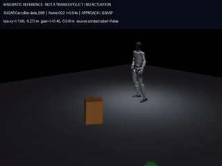
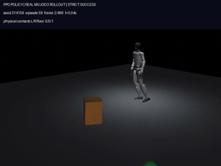

# 🤖 G1 Carry & Place：SuperMimic vs PPO

**一条 10 秒的抱箱示范，能否教会 G1 走过去、双手抱起、搬到另一处并放稳？** 我把 SUGAR CarryBox 的一条轨迹接进 **mjlab + MuJoCo**，在相同任务上对照“真实物理采样 + PPO-Sim”与“世界模型 + 可微分想象更新”的 SuperMimic 实现。先看箱子最终是否到目标附近，再分别看取搬放过程与持续双手抓握；代码、单条示范和真实物理评测证据都在这里。

| 🎞️ 示范：希望机器人怎样动 | ⚡ SuperMimic：看似搬放成功 | 🦾 PPO：连续双手抱箱成功 |
|:---:|:---:|:---:|
|  |  |  |
| [完整 MP4](assets/carry_place_reference_098.mp4) · **仅运动学指定姿态** | [完整 MP4](assets/sm4096_h32_ori12_iter1000_seed161803_episode0_physical.mp4) · **间歇持物通过 / 连续双手失败** | [完整 MP4](assets/ppo3999_seed314159_episode59_physical.mp4) · **严格连续双手通过** |

> **别被视频角标误导：**SuperMimic 视频标着 `STRICT FAILURE`，指原评测器要求“整个搬运段双手一刻不能松”的指标不通过；该片段**确实**举起并离地净搬运 1.526 m、到位放下。取搬放结果与持续稳定夹持是两个问题。[四个可播放案例与逐帧解释](docs/DEMOS.md) · [地面假接触核查](assets/sm4096_h32_ori12_iter1000_seed161803_episode0_floor_audit.png)

## ✨ 30 秒看结论：四组中最好的 SuperMimic 与 PPO

| 训练器 / 选中权重 | GPU / 同时仿真环境 | 训练至权重 / 完整训练 | 真实交互总量 | 稳态真实环境步/秒 | 训练峰值显存 | **主指标：终点箱体到位** | 过程：间歇持物 | 过程：连续双手 |
|---|---|---:|---:|---:|---|---:|---:|---:|
| **最佳 SuperMimic：H32 / 朝向 std 1.2，第 1,000 轮** | 1 × RTX 4090 / 4,096 | **3.75 h / 3.76 h** | 1,037 万 | 776 | 11,754 MiB | **124/128 = 96.9%** | 110/128 = 85.9% | 0/128 |
| **PPO-Sim：第 3,999 轮** | 4 × RTX 4090 / 8,192（每卡 2,048） | **2.58 h / 2.58 h** | 7.864 亿 | 86,216 | 6,288 / 4,922 / 4,922 / 4,922 MiB | **127/128 = 99.2%** | 127/128 = 99.2% | 53/128 = 41.4% |

**主指标只判位置**：每条物理回放的最后一帧，箱中心与目标中心的三维距离 ≤ **0.12 m** 则记 1，否则记 0；不要求箱体朝向、静止、放手或双手接触。表内两方法用相同种子 2027、314159 各 64 条**历史物理回放重新计分**，并非新的训练或新的 GPU rollout；过程指标沿用同批回放的几何校正结果。最佳 SuperMimic 第三个种子又到位 64/64，三种子共 **188/192 = 97.9%**，但连续双手仍是 **0/192**。因此到位率接近不等于完成稳定抓握。PPO 原始未校正严格成绩为 51/128，几何校正后为 53/128；两方法训练 GPU 数、网络和真实数据预算不同，不能据此声称同等质量的算法效率优势。显存为训练期间每 2 秒采样的整卡已用量峰值。[逐集新旧指标、源文件哈希与失败分析 →](docs/RESULTS.md)

另用原权重启动 [新一批 256 集独立物理复评](docs/RESULTS.md#新做的-256-集独立物理复评训练未继续)：SuperMimic 到位 **124/128**、间歇持物 **107/128**、连续双手 **0/128**；PPO 分别 **127/128、127/128、53/128**。历史与新批次的终点计数一致，过程事件存在小幅接触数值波动；续训已按要求停止，**这里没有新增训练权重或训练成绩**。

## 🧪 四个 SuperMimic 配方：单卡 4,096 环境

相同训练种子 0、相同一条 500 帧示范、相同 1,000 轮上限；**先用种子 0 的 16 条开发集选择检查点**，再用种子 2027 / 314159 / 161803 各 64 条评测。H 是**每个想象起点向未来展开的步数**，朝向 std 是箱体**朝向奖励尺度**（rad），不是仿真环境数或动作噪声。所有策略想象都分 16 块 × 256 起点累积梯度。

| H / 朝向 std | 单卡 GPU | 选中第几轮；达到时间 | 完整 1,000 轮 | 稳态真实环境步/秒 | 峰值显存 | **箱体到位：2027 / 314159 / 161803** | 过程：间歇持物（三种子） | 过程：连续双手 |
|---|---:|---:|---:|---:|---:|---:|---:|---:|
| 32 / 0.4 | 4 | 1,000；3.83 h | 3.84 h | 778 | 11,754 MiB | 59 / 58 / 61；**178/192 = 92.7%** | 153/192 = 79.7% | 0/192 |
| 16 / 0.4 | 5 | 800；1.91 h | 2.36 h | 1,278 | 10,904 MiB | 61 / 59 / 55；**175/192 = 91.1%** | 102/192 = 53.1% | 0/192 |
| **32 / 1.2** | **6** | **1,000；3.75 h** | **3.76 h** | **776** | **11,754 MiB** | **64 / 60 / 64；188/192 = 97.9%** | **168/192 = 87.5%** | **0/192** |
| 16 / 1.2 | 7 | 800；1.94 h | 2.39 h | 1,266 | 10,904 MiB | 39 / 46 / 46；**131/192 = 68.2%** | 93/192 = 48.4% | 0/192 |

**关键取舍：**H16 快约 1.6×，但“更新更快”不必然等于“最终抱箱更稳”。H16/1.2 第 800 轮被选中，第 1,000 轮任务结果下降；单看世界模型损失或训练 reward 会漏掉退化。H32/1.2 可以在一张 4090 上约 3.75 小时训出明显可见的取搬放，但持续双手握持仍是**0/192**。每组真实交互量 **10,371,072**（含 replay 预填充），想象 rollout 是模型计算，不算真实 MuJoCo 步数。[更细的时序与失败原因 →](docs/RESULTS.md)

## 🧠 方法：同任务，梯度路径不同

~~~mermaid
flowchart LR
    D["SUGAR data_098 1 条 × 500 帧"] --> R["G1 + 箱体参考 足底/手箱几何修正"]
    R --> E["mjlab + MuJoCo 真实接触、同观测与域随机化"]
    E --> P["PPO-Sim 物理 rollout + 优势估计"]
    E --> M["SuperMimic 真实 replay → 世界模型"]
    M --> I["4,096 个想象起点 H16 / H32 可微展开"]
    P --> V["统一物理复评 终点三维到位 + 两项过程指标"]
    I --> V
~~~

- **PPO-Sim** 从仿真批量采集实际交互，经 PPO 优势估计/更新策略；训练步速高，消耗更多**真实仿真**转换。这里的 `--learner ppo` 不是仓库别处的 AMP-PPO Lift 实验。
- **SuperMimic** 从真实仿真数据拟合状态转移模型，在模型里用 4,096 个起点做短时域想象，将跟踪奖励梯度穿过世界模型更新策略；模型误差、接触非光滑和箱体终点姿态都可能影响操作。`16×256` 是同一次 4,096 起点更新的**显存分块**，不是四个 epoch，也不是多开 4,096 个真实仿真环境。
- **观察与局限**：世界模型接收机器人+箱体的状态与随机化信息（含 84 维物理状态），本实验没有摄像头闭环、力觉或真机验证；仿真中特权状态可得不代表真机可直接部署。[模型输入与实现](src/mjlab_g1/rl/supermimic/features.py) · [策略更新](src/mjlab_g1/rl/supermimic/algorithm.py)。

## 📦 Dataset 与任务

- **只训练一条参考**：SUGAR CarryBox `data_098`，10 秒、50 Hz、500 帧；同时含 G1 29 关节、身体轨迹、箱体 6D 位姿/速度和接触标签。源 processed 数据虽有 100 条、49,043 帧（87 条可转换），当前策略**只读一条修正后的 v2**。原轨迹→接触 v1→足底+手箱 v2 的文件和 [SHA/字段说明](dataset/README.md) 随仓库提供。
- **物理任务**：29 DoF G1，0.5 kg 箱体（约 0.400×0.546×0.536 m），从地面取、至少离地搬运 0.5 m、到目标区域松手并站稳；控制 50 Hz。示范的箱体位姿是追踪目标，**不是强制绑定到机器人手上**。[任务定义](src/mjlab_g1/tasks/smtrack/env_cfgs.py) · [真实物理评分](src/mjlab_g1/tasks/smtrack/carryplace_eval.py)。
- **为何修正参考**：原始转换的持物时手箱穿透 p95 达 9.51 cm，接近阶段仅 23.0% 的帧有脚部接地；v2 几何审计分别改善为 0.21 cm 和 98.7%。几何修正并不保证动力学可实现。[数据审计](dataset/README.md)。

## 🛠️ 环境与复现入口

实测：**Ubuntu 20.04.1 LTS · RTX 4090 · 驱动 550.144.03 · Python 3.10.13（wan） · PyTorch 2.6.0+cu124 · mjlab 1.4.0 · MuJoCo 3.10.0 · mujoco-warp 3.8.0.3 · warp-lang 1.14.0**。GPU 驱动安装于**宿主机**，仅有 conda 环境不足以运行 CUDA 仿真；源码直跑与新建环境的 Python 版本边界见 [ENVIRONMENT.md](docs/ENVIRONMENT.md)。本仓库不使用上游 `uv.lock` 的更新版 torch 解析结果覆盖 2.6.0。

~~~bash
# 仓库根目录，已进入具备上述依赖的 Linux conda 环境
python scripts/verify_report.py
python scripts/rescore_terminal_placement.py  # 重新评分旧物理回放，不需要 GPU
git lfs pull                          # 首次克隆后下载两份原权重
export PYTHONPATH=src MUJOCO_GL=disable
python -m unittest discover -s tests -p 'test_carryplace_eval.py' -v
bash scripts/eval_checkpoints.sh supermimic 0 2027 64  # 另跑新的 64 集物理评测
bash scripts/eval_checkpoints.sh ppo 0 2027 64

# 历史 PPO 配方：4 卡 × 2,048 环境 = 全局 8,192
CARRY_MASTER_PORT=29571 CARRY_SAVE_INTERVAL=100 bash scripts/run_carry_experiment.sh \
  ppo 0,1,4,5 8192 4000 cp_ppo_v2_s0_4g

# 最佳 SuperMimic 配方：cuda:6 单卡、4,096 环境，H32 / std1.2
CARRY_SAVE_INTERVAL=100 bash scripts/run_carry_experiment.sh \
  supermimic 6 4096 1000 sm4096_h32_ori12_s0 \
  --imag-microbatches 16 --lr-cosine-iters 250000 --imagination-horizon 32 --box-ori-std 1.2
~~~

两份 [checkpoint 与原始 agent 配置](checkpoints/README.md) 已随仓库通过 Git LFS 提供；直接评测脚本默认选择仓库权重，也支持第 5 个参数指定外部 checkpoint。两条从头训练各耗时数小时；重训、64 集随机化物理评测与完整命令见 [REPRODUCE.md](docs/REPRODUCE.md)。`scripts/verify_report.py` 和 `scripts/rescore_terminal_placement.py` 只处理归档数据，不伪装成新的训练或 GPU 实验。

## 🔎 踩坑与下一步

1. **视觉与判据分层**：最佳配方箱子终点到位 97.9%、间歇持物完整流程 87.5%，同时不间断双手仍 0%；[一个“看似成功”的严格失败片段](assets/demo_sm_contact_failure.gif)与[接触时序](assets/sm2000_seed314159_episode47_contact_timeline.png)可以直观解释差异。
2. **物理状态反证评分器**：箱中心 0.924 m 时仍标“触地”不可能；网格最大顶点半径 0.29545 m。只过滤中心高度 >0.33 m 的假触地后重评，保留低位拖行和真正失败；几何变更时阈值必须重推。[修正、回归与回放证据](docs/RESULTS.md)。
3. **下一项真正值得做的实验**：给双手相对箱体的接触/滑动设置独立指标和训练约束，再用**多个训练种子**、相同 GPU·h/仿真步预算、统一严格物理判据复评；箱重 3 kg、不同箱型与真实传感器闭环尚未在本仓库证明。

代码来源与资产许可边界见 [THIRD_PARTY.md](THIRD_PARTY.md)。这是**单任务工程复现**，没有声称实现 SUGAR 论文原 tracker、复现未开源视频作者的私有代码或验证 SuperMimic 论文的 1000× 数字。
